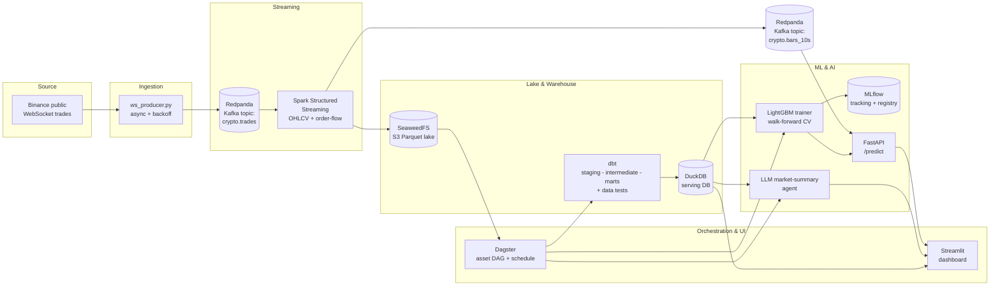

# CryptoStream — Architecture

## System diagram



## Skill coverage (why this project works for four job families)

| Job family | What in this repo demonstrates it |
|---|---|
| **Data Engineering** | Kafka/Redpanda ingestion, Spark Structured Streaming, SeaweedFS S3 data lake, Dagster orchestration, Dockerized services |
| **Data Analytics** | dbt models (staging → intermediate → marts), data-quality tests, technical indicators, Streamlit BI dashboard |
| **Data Science** | Feature engineering, walk-forward time-series validation, LightGBM classifier, MLflow experiment tracking |
| **AI / ML** | Model serving via FastAPI, model reload/monitoring hooks, LLM market-summary agent (RAG-style over live stats) |

## Data contracts

**Kafka topic `crypto.trades`** (one JSON message per trade):

```json
{
  "symbol": "btcusdt",
  "trade_id": 12345,
  "price": 62000.5,
  "quantity": 0.01,
  "trade_time": 1700000000000,
  "is_buyer_maker": false,
  "ingest_time": 1700000000050
}
```

**Kafka topic `crypto.bars_10s`** (one JSON message per update, keyed by symbol, kept
for one hour). The same bar arrives many times while it forms; the newest copy wins.

```json
{
  "symbol": "btcusdt",
  "window_start": 1700000000000,
  "window_end": 1700000010000,
  "open": 62000.5, "high": 62010.0, "low": 61995.0, "close": 62005.0,
  "volume": 1.25, "vwap": 62003.1, "trade_count": 42,
  "net_signed_volume": 0.3, "order_flow_imbalance": 0.24
}
```

**Feature table `features/ohlcv_10s`** (10-second bars per symbol, times in plain UTC):
window_start, window_end, open, high, low, close, volume, vwap, trade_count,
net_signed_volume, order_flow_imbalance. Files under `symbol=<s>/`:

| File | Written by |
|---|---|
| `part-*.parquet` | Spark, once a minute |
| `compact-<YYYYMMDDHH>.parquet` | Dagster's compaction, one per finished hour |
| `backfill-<YYYY-MM-DD>.parquet` | the Binance history backfill, one per day |
| `sample.parquet` | the offline sample generator (local lake only) |

**ML mart `marts.mart_ml_features`**: feature vector + `label_up_3` (1 if the close of
the bar exactly 30s later is higher than the current close; rows with no bar at +30s
have no label).

## Two ways to run

1. **Offline demo (fastest, no Docker/network):** `make seed` generates realistic
   synthetic bars → `make dbt` → `make train` → `make api` + `make dashboard`. For real
   data instead, `make backfill-local DAYS=2` then `make refresh`.
2. **Full live stack:** `make up` starts Redpanda, SeaweedFS, Spark, Dagster, MLflow, the
   API and dashboard in Docker; the ingestion service streams live Binance trades.
   Dagster builds marts + retrains on a 15-minute schedule.

## Fast path and slow path

The model predicts 30 seconds ahead, so its inputs must be fresher than that.

- **Slow path (complete, for training):** Spark appends finished bars to the lake, and
  Dagster rebuilds the warehouse and retrains every 15 minutes.
- **Fast path (recent, for serving):** Spark publishes bars to `crypto.bars_10s` every 2
  seconds. The API keeps the last 400 per symbol in memory and the dashboard reads them.

`/predict/{symbol}` uses the newest finished bar from the fast path. The bar still
forming is skipped because the model never saw a partial bar in training, and a bar
only counts as finished 5 seconds after it ends, which leaves time for Spark's final
update. If the feed has fewer than 31 bars or its newest finished bar is over 30
seconds old, the API falls back to the warehouse. The `source` field in the response
says which one was used.

`with_indicators()` in `ml/features.py` repeats the indicator logic from
`int_technical_features.sql` in Python, for the live view and for training when dbt
hasn't run. A test compares the two on data with gaps, so a change to one fails until
the other matches.

## Keeping the data honest

- **Time, not rows.** Rolling windows cover fixed spans of time (300s for "30 bars",
  60s for "6 bars"). A return only exists when the previous bar is exactly 10 seconds
  earlier, and a label only when a bar exists exactly 30 seconds later. A gap in the
  feed (a quiet symbol, or the stack being off overnight) never joins prices from
  either side of it.
- **One bar per window.** Spark replays a batch after a restart, and the backfill
  overlaps what Spark wrote. Staging keeps the copy with the most trades, and a dbt
  test fails the build if a duplicate gets through.
- **Plain UTC.** Lake files can carry time-zone-aware or plain timestamps. Loading
  converts them all to plain UTC, so views read the same on any machine.
- **Open and close by trade time.** Spark takes them from the earliest and latest
  trade in the window, not from whichever trade arrived first.
- **No leakage, calibrated output.** Training splits are purged around the 30s label,
  and probabilities are calibrated on held-out data, with baselines in every run's
  metrics.

## History backfill

`make backfill` (Docker) or `make backfill-local` loads `DAYS` (default 7) of real
history. Finished days come from Binance's bulk files at data.binance.vision, one
checksummed download per symbol per day; today comes from the REST API. 1s klines are
rolled up into the same 10s bars Spark writes, with order flow from each kline's
taker-buy volume. Seven days for three symbols take about three minutes.

## Lake housekeeping

Spark writes the lake once a minute. Each Dagster run first merges every finished hour
of Spark files into one `compact-<hour>.parquet` per symbol, dropping duplicates, and
deletes raw trades older than `RAW_RETENTION_DAYS` (default 7). The 10s bars are kept:
they are the training history, and small once compacted.

## Shared storage in Docker

| Volume | Written by | Read by |
|---|---|---|
| `redpanda-data` (Kafka topics) | Ingestion, Spark | Spark, API |
| `lake-data` | Spark, through the S3 API | Dagster, through the S3 API |
| `warehouse-data` (DuckDB file) | Dagster | API, dashboard |
| `models-data` | Dagster | API |

`make down` keeps every volume. Spark's checkpoints live in `lake-data` and point at
offsets in `redpanda-data`, so wipe them together with `make clean`, never one alone.

Spark also keeps the state of its bar aggregation in those checkpoints, and refuses to
reuse it once the aggregation code changes. After such a change, `make reset-bar-state`
clears the state of just the two bar queries (and the lake sink's file log, which would
otherwise skip the new batches). They then rebuild from the trades Kafka still holds;
the overlap with bars already in the lake is removed by staging's deduplication.

DuckDB locks a file against other processes, so Dagster never writes the served file.
It builds a copy in `.build/` and renames it over the served file after dbt's tests
pass. A failed build leaves the last good warehouse in place.
